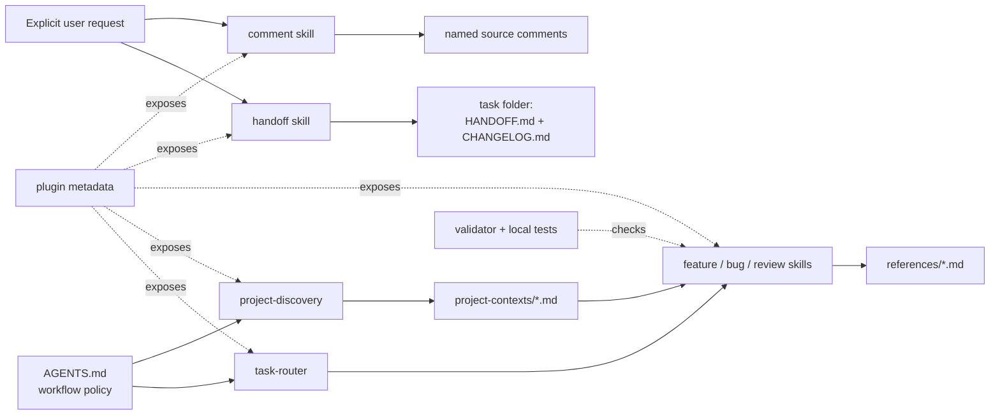
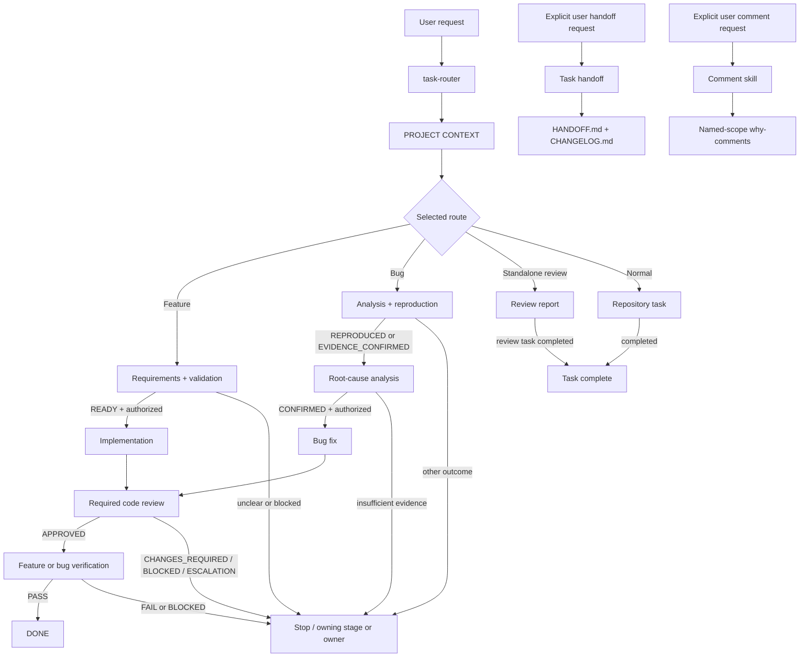

# PROJECT CONTEXT

- Target: `/Users/snsean/Desktop/code/agent_skills` (Git repository containing the `agent-skills/` package).
- Saved path: `agent-skills/project-contexts/agent-skills.md`.
- Revision: pc15.
- Status: CURRENT for repository-level architecture; the Git baseline is a point-in-time observation.
- Selected route / scope: Make the single `agent-skills/` folder a Claude Code-only plugin with plugin evals.
- Repository baseline observation: Git root at `/Users/snsean/Desktop/code/agent_skills`, branch `main`, HEAD `6abd457` with uncommitted pc14/pc15 package edits at refresh time. Recheck HEAD and worktree state before reusing check or review evidence. This snapshot does not claim that Git state remains unchanged.
- Sources: `README.md`, `agent-skills/AGENTS.md`, `agent-skills/skills/README.md`, package manifests under `agent-skills/`.
- Freshness basis: Directly inspected the package layout for pc15. Recheck governing instructions, manifests, and worktree status before reusing affected facts.
- Prior revision / changes: pc13 removed repository-root adapters. pc14 adds the Claude Code manifest and marketplace, the `fresh-reviewer` subagent, the `evals/` plugin-eval suite, the saved-state rule, and a router that continues into the selected stage. pc15 removes all Codex packaging, the Codex runner, and `$skill` syntax (version 2.0.0). Architecture visuals from pc13 are reused with the changes noted below.

## Repository Topology

```text
agent_skills/                         # Git workspace (not copied into host projects)
├── README.md                         # points at the package folder
└── agent-skills/                     # only folder to add to another project
    ├── AGENTS.md                     # package workflow instructions
    ├── .claude-plugin/               # Claude Code manifest and marketplace
    ├── agents/fresh-reviewer.md      # Claude Code review-gate subagent
    ├── evals/                        # claude plugin eval cases (24)
    ├── project-contexts/            # saved repository maps (vendored layout)
    └── skills/
        ├── task-router/             # route selection
        ├── project-discovery/       # repository map
        ├── handoff/                 # task context reset
        ├── comment/                 # necessary why-comments
        ├── feature-workflow/        # feature stages
        ├── bug-workflow/            # bug stages
        ├── code-review-workflow/    # review stages
        ├── references/             # shared evidence guidance
        ├── scripts/                # package validation
        └── evals/                  # decision probes and local tests
```

- Boundaries / excluded areas: One Git repository; no nested `.git` directory was found in the inspected tree. `.git/` internals and historical evaluation result bodies are outside this context's scope. No generated, vendor, or application build tree was observed in the relevant file listing. Host projects should receive only `agent-skills/`.
- Tree evidence: `README.md`, `agent-skills/skills/README.md` layout, package manifests, and the inspected file listing under `agent-skills/`. The `handoffs/` directory is currently absent; the handoff skill creates a task folder there when explicitly requested.

## Governing Instructions

- `agent-skills/AGENTS.md`: package-level workflow when the `agent-skills/` directory is in the workspace. It directs PROJECT CONTEXT snapshots to `project-contexts/`, user-requested task handoffs to `handoffs/`, and other artifacts to the conversation by default.
- `agent-skills/skills/project-discovery/SKILL.md`: discovery may write only its context Markdown file, uses repository evidence, refreshes material facts, distinguishes a CURRENT architecture map from its point-in-time Git observation, and reports unavailable persistence.
- `agent-skills/skills/handoff/SKILL.md`: its description limits it to an explicit user request; it creates the parent directory if needed, writes a handoff and changelog under `<taskID>-<description>/`, and keeps its own content manifest. An unfinished checkpoint remains labeled CHECKPOINT.
- `agent-skills/skills/comment/SKILL.md`: only an explicit `/comment` or comment request invokes the skill; it adds why-comments for complex or non-obvious logic and skips redundant what-comments.

## Technology and Tooling

- Languages/runtimes: Markdown is the primary workflow format; Bash scripts provide validation and verification helpers; Python 3 scripts provide native-package validation and behavioral evaluation (`skills/scripts/`, `skills/evals/`).
- Frameworks/platforms: Claude Code plugin packaging via `.claude-plugin/plugin.json` (version 2.0.0) and `.claude-plugin/marketplace.json`; no application framework is declared in inspected manifests.
- Package/workspace/build tools: Git; Bash; Python 3 standard library (`json`, `re`, `unittest`, `subprocess`, etc. in inspected scripts). No application package manager or build manifest was found in the relevant repository listing.
- Infrastructure/storage/external systems: Markdown files and Git provide persistent project data. Measured behavior comes from `claude plugin eval`; live plugin loading is outside repository-only evidence.

## Structure and Responsibilities

| Path / component | Responsibility and boundary | Evidence |
| --- | --- | --- |
| `skills/task-router/` | Selects one route including HANDOFF and COMMENT, then continues into the entry skill unless only the route was requested | `task-router/SKILL.md` |
| `skills/project-discovery/` and `project-contexts/` | Creates and stores versioned repository maps under the saved-state root | `project-discovery/SKILL.md`, `references/state-storage.md` |
| `agents/fresh-reviewer.md` | Claude Code subagent that performs the REQUIRED GATE review from a packet only | `independent-review.md` |
| `evals/` | `claude plugin eval` cases: natural trigger per skill, negatives, scaffolded edits | `evals/README.md`, `validate_claude_package.py` |
| `skills/handoff/` and `handoffs/` | On explicit user request, captures a completed task or unfinished checkpoint as two files per `<taskID>-<description>/` folder | `handoff/SKILL.md` |
| `skills/comment/` | On explicit user request, adds necessary why-comments and removes redundant what-comments in a named scope | `comment/SKILL.md`, examples |
| `skills/feature-workflow/`, `bug-workflow/`, `code-review-workflow/` | Stage contracts, gates, report templates, and required-gate independent review packet guide | Representative `SKILL.md` files; `code-review/references/independent-review.md`; `agent-skills/AGENTS.md` |
| `skills/references/check-evidence.md` | Shared executed-check provenance | `check-evidence.md` |
| `skills/scripts/` and `skills/feature-workflow/verification/scripts/` | Package validation and focused verification helpers | `validate-skill-system.sh`, `verify.sh` |
| `skills/evals/` | Source decision scenarios, packet builder, and unit tests | `build_packet.py`, `behavioral-evals.md` |

## Architecture and Flows

Component relationships (arrows show documented references or inputs, not measured runtime calls):



- Architecture / dependency evidence: `agent-skills/AGENTS.md`, `.claude-plugin/plugin.json`, `skills/task-router/SKILL.md`, `skills/project-discovery/SKILL.md`, `skills/handoff/SKILL.md`, `skills/comment/SKILL.md`, and `skills/scripts/validate_claude_package.py`.
- Style / boundary notes: File-based contract and handoff workflow. Skills define stage outcomes; linked templates define artifact fields. The plugin manifest exposes skill roots; validator and evaluation scripts inspect package files.

Task flow (repository-dependent path; arrows state the required advancement status):



- Workflow / data-flow evidence: `agent-skills/AGENTS.md` workflow diagrams and artifact rules, `skills/feature-workflow/requirement-validator/SKILL.md`, `skills/bug-workflow/bug-reproduction/SKILL.md`, `skills/bug-workflow/bug-root-cause/SKILL.md`, `skills/code-review-workflow/code-review/SKILL.md`, `skills/handoff/SKILL.md`, and `skills/comment/SKILL.md`. Stop outcomes retain their owner and resume conditions; FAIL returns through its owning stage and review. An explicit unfinished handoff records CHECKPOINT and open items rather than DONE.
- Text fallback: The router selects a route and repository work uses PROJECT CONTEXT. Feature implementation needs READY and authority; bug fixing needs confirming reproduction evidence, a confirmed cause, and authority. Feature/bug changes need APPROVED review and verification PASS before DONE. Handoff and comment run only on explicit user request; comment also requires a named scope before editing.
- Evaluation flow: `claude plugin eval .` runs the `evals/` cases with and without the plugin and grades each run. Separately, `build_packet.py` assembles a self-contained scenario packet without calling a model.

## Project Notes and Edge Cases

- Notes: Only `agent-skills/AGENTS.md` governs the package. Skill-system maintenance requires updating `skills/CHANGELOG.md` and running the structural validator from the package root.
- Notes: PROJECT CONTEXT is the persistent exception to the package's conversation-only artifact default. Refresh only materially affected facts and keep the saved path in discovery handoff (`project-discovery/SKILL.md`).
- Notes: User-requested task handoffs are the other persistent artifact exception. A fresh session reads the handoff, its task changelog, PROJECT CONTEXT, and current instructions, then checks content fingerprints and baseline freshness before reusing evidence (`handoff/SKILL.md`).
- Notes: Explicit `/comment` or comment requests require a named file/symbol/diff scope before any edit; the skill asks once and leaves the tree unchanged until scope is confirmed (`comment/SKILL.md`).
- Edge cases: A dirty worktree can invalidate prior review or check evidence even when HEAD is unchanged. Preserve unrelated changes and identify the actual content baseline (`AGENTS.md`, `skills/references/check-evidence.md`).
- Edge cases: Read-only review cannot fix findings without explicit fix authority; required approval needs a fresh reviewer context. Verification cannot claim PASS from missing required evidence, and repeated blocking review or verification failures have stop limits (`agent-skills/AGENTS.md`, `code-review/SKILL.md`).
- Edge cases: `verify.sh` prints changed files and related test candidates, but runs a check only when arguments follow `--`; name-matched tests are candidates, not complete coverage (`verification/scripts/verify.sh`, `related-tests.sh`).
- Edge cases: The structural validator can pass without proving live client discovery or application behavior (`skills/README.md`, `validate-skill-system.sh`). `claude plugin eval` hides case files from the agent and runs each case in an empty, isolated workspace (`evals/README.md`).
- Unverified assumptions: Whether this client currently discovers the edited local plugin is not established by repository files; confirm in the target client if discovery behavior becomes relevant. No application runtime behavior was exercised during this read-only inspection.

## Entry Points and Interfaces

- `agent-skills/AGENTS.md`: package workspace instruction entry point.
- `agent-skills/.claude-plugin/plugin.json`: Claude Code manifest; adds the three workflow folders to the default `skills/` scan and registers `agents/fresh-reviewer.md`. Claude Code does not read `AGENTS.md`.
- `agent-skills/evals/`: `claude plugin eval .` suite; `skills/scripts/validate_claude_package.py` checks it offline.
- `agent-skills/skills/*/SKILL.md`: stage contracts loaded for the selected route; `references/*.md` are output schemas.
- `agent-skills/skills/scripts/validate-skill-system.sh`: structural validation command, defaulting to the `agent-skills/` package root.
- `agent-skills/skills/evals/build_packet.py`: offline scenario packet builder.

## Commands and Conventions

- Build/run: No application build or server run command is documented. The package is used by opening a workspace with its `AGENTS.md` or explicitly supplying it (`skills/README.md`).
- Test: From the package root, `python3 -m unittest discover -s skills/evals -p 'test_*.py'` is documented for local regression tests (`skills/README.md`).
- Lint/typecheck/static: From this workspace root, `bash agent-skills/skills/scripts/validate-skill-system.sh`; the script checks Markdown links and contract markers, Bash syntax, and native plugin coverage (`AGENTS.md`, validator source). No separate lint or typecheck command was found in inspected docs.
- Conventions: Skills have constrained YAML frontmatter, required `Walk It Down` Start/Expand/Stop fields, and linked templates; status and revision fields carry stage decisions (`validate-skill-system.sh`, `skills/README.md`).
- Command status: Initial discovery used read-only inspection commands (`git`, `rg`, `find`, `cat`, `sed`) and ran no tests. Earlier handoff-skill maintenance ran the structural validator and local unit tests, but its saved task handoffs and source manifest were removed at the user's request; those historical results are UNKNOWN for reuse. No application or behavioral probe was run for discovery.

## Task-Relevant Map

- Current request: Make the single distributable `agent-skills/` folder a Claude Code-only plugin with plugin evals.

## Risks and Unknowns

- R1: No saved task handoff currently exists. Historical review and check results formerly summarized in removed artifacts cannot be independently reused. A future reader must compare current Git content and executed evidence before relying on those results.
- U2: No application runtime exists in inspected manifests/docs, and no full behavioral evaluation was run. This does not block repository-level context; structural and behavioral claims need their respective checks.
- U3: The `claude` CLI was not installed when pc14 was written, so `claude plugin validate` and `claude plugin eval` have not run against this package. Structural validation and scaffold dry-runs passed; measured Claude scores remain unknown.

## Handoff

- Context disposition: CURRENT for this repository's workflow/package architecture; refresh only affected facts after relevant edits.
- Next stage / owner: Future repository-dependent work may reuse pc15 after a freshness check.
- Required refresh triggers: Changed governing instructions, plugin manifests, stage contracts, templates, validator/evaluation architecture, or another change affecting a fact cited here. A different commit alone is insufficient.
- Remaining action: None for discovery; live client discovery and behavior checks remain separate if later requested.
